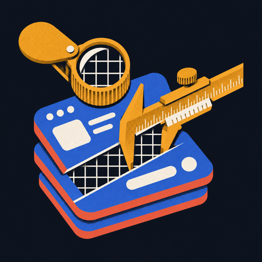
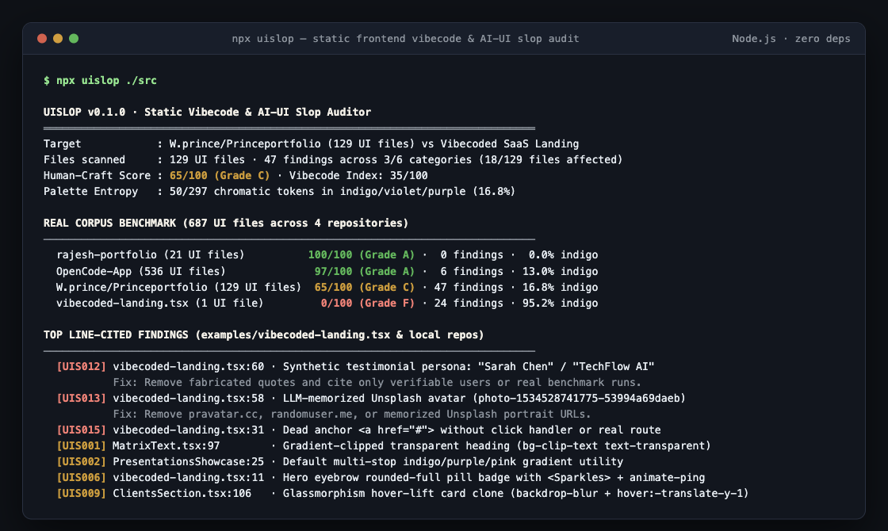

# uislop

<p align="center">
  
</p>

Zero-dependency static linter for AI-generated ("vibecoded") frontend UI tells across React (`.tsx`/`.jsx`), Next.js, Vue, Svelte, Astro, Tailwind CSS, and HTML.



## Install & Run

```bash
npx uislop
```

No API keys, no network calls, and zero npm dependencies. Point it at any frontend directory or file:

```bash
# Audit your current frontend project
npx uislop ./src

# Run the bundled synthetic vs real comparison demo
npx uislop --demo

# Fail CI if Human-Craft Score drops below 80
npx uislop ./src --fail-under 80 --format github

# Emit JSON for scripts or agent loops
npx uislop ./src --json
```

## Why this exists

When Claude Code, Cursor, v0, Bolt, or Lovable generates a landing page or dashboard without strict design constraints, it converges on the same visual defaults: `from-indigo-500 via-purple-500 to-pink-500` gradient-clipped headings, `lucide-react` `<Sparkles />` pill badges, 3-column `backdrop-blur` hover-lift card grids, hardcoded `"Sarah Chen, CTO at TechFlow"` testimonials with memorized Unsplash portrait IDs (`photo-1534528741775-53994a69daeb`), and hollow `href="#"` or `onClick={() => console.log(...)}` controls.

`uislop` catches 16 concrete, line-cited frontend tells (`UIS001` through `UIS016`) across 6 categories and computes a 0-100 **Human-Craft Score** (`Grade A` to `F`).

## Real benchmark across 3 local codebases (686 UI files)

| Codebase | UI Files | Findings | Indigo/Violet Share | Human-Craft Score |
|---|---:|---:|---:|---|
| `rajesh-portfolio` (hand-crafted editorial site) | 21 | 0 | 0.0% | **100/100 (Grade A)** |
| `OpenCode-App` (desktop IDE & SSH client) | 536 | 6 | 13.0% (13/100) | **97/100 (Grade A)** |
| `W.prince/Princeportfolio` (older multi-page site) | 129 | 47 | 16.8% (50/297) | **65/100 (Grade C)** |
| `examples/vibecoded-landing.tsx` (unprompted LLM SaaS page) | 1 | 24 | 95.2% (20/21) | **0/100 (Grade F)** |

### Two calibration bugs we caught building this

1. **Code-block and syntax-theme false positives:** My first pass scanned raw file strings and immediately flagged `<pre><code>` documentation snippets and terminal ANSI color themes in `OpenCode-App` for containing `indigo` tokens and example `href="#"` tags. `uislop` masks out comments, `<pre>`, `<code>`, and `<svg>` blocks while preserving exact `\n` line offsets, and skips syntax/theme/story/test files by default.
2. **Corpus-size penalty distortion:** Subtracting raw rule weights globally gave the 536-file `OpenCode-App` repo a `68/100 (Grade C)` when 99.1% of its files had zero findings (only 2 dialogs used indigo utilities and 3 routes had an em-dash). `uislop` normalizes category penalties by corpus square-root density (`sqrt(4 / filesScanned)` for cosmetic categories, `sqrt(12 / filesScanned)` for trust/wiring errors) so large production repos aren't scored like a single 80-line landing file.

## Rules (`npx uislop --rules`)

| ID | Category | Weight | Rule | What it catches |
|---|---|---:|---|---|
| `UIS001` | `palette` | -8 | `gradient-text-hero` | `bg-clip-text text-transparent bg-gradient-to-*` on headings |
| `UIS002` | `palette` | -7 | `indigo-violet-gradient` | `from-indigo-*/via-purple-*/to-pink-*` multi-stop gradients |
| `UIS003` | `palette` | -6 | `indigo-monoculture` | `indigo`/`violet`/`purple` > 35% of chromatic utilities in a file |
| `UIS004` | `palette` | -5 | `floating-blur-blobs` | `blur-3xl rounded-full opacity-20` decorative background glow orbs |
| `UIS005` | `icons` | -7 | `lucide-cliche-cluster` | Importing >= 3 of `Sparkles`, `Zap`, `Rocket`, `Shield`, `Brain`, `Wand2`, `Bot`, `Cpu` |
| `UIS006` | `icons` | -6 | `sparkle-eyebrow-pill` | `rounded-full` pill badge with `<Sparkles>` or `animate-ping` dot above `<h1>` |
| `UIS007` | `icons` | -5 | `tinted-squircle-icon-grid` | Repeated `bg-*-500/10 rounded-xl p-3` icon containers |
| `UIS008` | `layout` | -6 | `three-col-card-monotony` | Multiple `grid-cols-1 md:grid-cols-3` uniform card grids in one view |
| `UIS009` | `layout` | -5 | `glass-lift-card-clone` | `backdrop-blur` + `hover:-translate-y-1` glass card template |
| `UIS010` | `copy` | -7 | `ai-hero-buzzwords` | `"Supercharge your"`, `"Unleash the power of"`, `"Built for modern teams"`, `"Seamless integration"` |
| `UIS011` | `copy` | -4 | `em-dash-ui-copy` | Em-dash (`—`) clause splices inside visible UI copy |
| `UIS012` | `trust` | -9 | `fake-testimonial-cast` | `"Sarah Chen"`, `"Alex Rivera"`, `"Acme Corp"`, `"TechFlow"`, `"Nexus AI"` |
| `UIS013` | `trust` | -8 | `stock-avatar-urls` | `pravatar.cc`, `randomuser.me`, or LLM-memorized Unsplash portrait IDs |
| `UIS014` | `trust` | -6 | `unverified-vanity-triad` | Hardcoded `"10,000+ developers"`, `"99.9% uptime"`, `"500+ teams"` |
| `UIS015` | `wiring` | -7 | `dead-anchor-href` | `<a href="#">` or `<a href="">` without a click handler |
| `UIS016` | `wiring` | -8 | `noop-event-handler` | `onClick={() => {}}`, `onClick={() => console.log(...)}`, or bare `preventDefault` |

## Honest limitations

- **Static source analysis only:** `uislop` inspects JSX/TSX/Vue/Svelte/HTML class strings and markup without running a headless browser or computing live CSS cascade styles. If your indigo gradient lives inside an external compiled stylesheet rather than utility classes, `uislop` will not see it.
- **Intentional purple brand palettes:** If your brand's actual primary color is indigo or violet, `UIS003` (`indigo-monoculture`) will flag files where >35% of chromatic utilities are indigo/violet. Define semantic aliases (`bg-brand-primary`) in your Tailwind config so intentional brand tokens are distinguished from raw `indigo-500` defaults.
- **Passing `uislop` does not guarantee good visual design:** Removing `Sparkles` badges and fake `Sarah Chen` quotes eliminates obvious AI-slop tells, but typographic hierarchy, spacing rhythm, and layout originality still require human taste.

## License

MIT · [Prince Jain](https://www.prince.sh)
